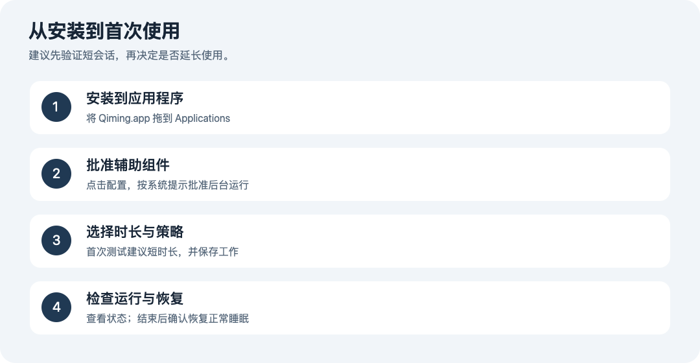
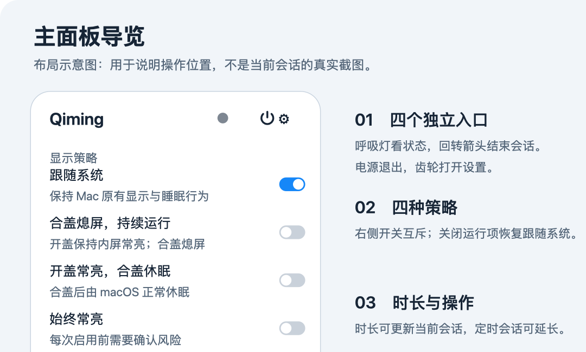
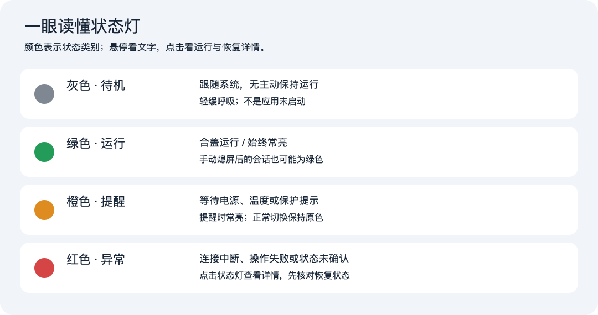
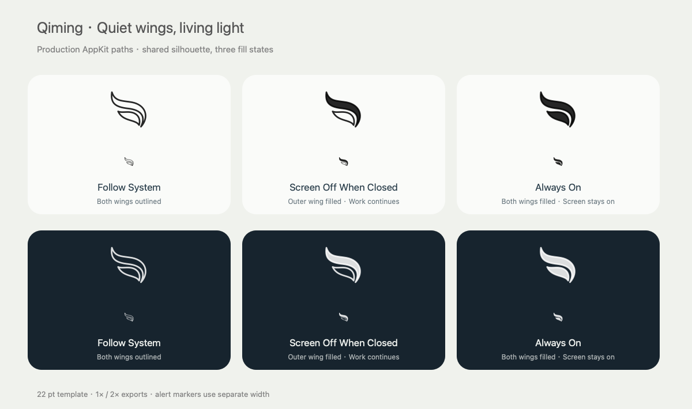

# 栖明·Qiming使用手册

版本：0.1.1 · 文档日期：2026-11-04 · Apple Silicon / macOS 14 或更新版本

栖明·Qiming 是菜单栏中的显示与睡眠策略工具。打开后主面板会从顶部菜单栏羽翼图标下方展开。左键单击图标即时打开／关闭面板；右键点击可快速开始策略 2，再次右键结束会话。

首次启动、退出后重新打开，以及运行中再次打开应用，都使用菜单栏图标的位置展开主面板。系统尚未完成菜单栏定位时，应用会等待图标就位后再显示面板。

> 本使用包为 Release 构建，使用 Apple Development 证书签名，未经过 Developer ID 分发签名和 Apple 公证。它用于当前本机使用和验证，不是已完成跨设备分发及全部合盖实机验收的正式发行版。绿色状态或请求成功不等于已验证物理屏幕状态。

## 目录

1. [安装与首次配置](#1-安装与首次配置)
2. [主面板与基本操作](#2-主面板与基本操作)
3. [四种显示策略](#3-四种显示策略)
4. [呼吸灯与菜单栏图标](#4-呼吸灯与菜单栏图标)
5. [时长、熄屏与结束会话](#5-时长熄屏与结束会话)
6. [通用设置与保护设置](#6-通用设置与保护设置)
7. [实机验证建议](#7-实机验证建议)
8. [异常处理与诊断](#8-异常处理与诊断)
9. [更新、卸载与版本区分](#9-更新卸载与版本区分)
10. [已知限制与使用边界](#10-已知限制与使用边界)

## 1. 安装与首次配置

### 1.1 安装

- **DMG 安装包**：双击磁盘映像，将 `Qiming.app` 拖到 `Applications`（应用程序）替身中。复制完成后推出磁盘映像，从“应用程序”启动 Qiming。
- **ZIP 使用包**：解压后，将其中的 `Qiming.app` 放入“应用程序”。保留“使用手册”文件夹及其 `assets` 子目录，文档插图需要这些文件。
- 安装包已包含主程序、辅助组件、图标及中英文资源；使用时不需要安装 Python、Swift 或 Xcode。开发证书签名对其他 Mac 的适用性仍需单独验证。
- 更新已有版本前，先结束会话并退出旧版本，再替换应用。不要从磁盘映像或下载目录长期运行。

如果系统提示无法验证开发者、证书或阻止打开，请保留提示以便诊断。当前包未经公证，不能保证在其他 Mac 上直接运行；不要通过关闭系统安全保护来解决。

### 1.2 启用辅助组件

1. 打开 Qiming，主面板会自动从菜单栏下方展开；如果已收起，左键点击羽翼图标即可打开。
2. 首次选择需要保持运行的策略时，若出现“启用合盖支持”，点击“配置…”。也可从“设置 → 保护”中的辅助组件操作区配置。
3. 按提示进入系统设置，批准 Qiming 的后台辅助组件。系统要求认证时，使用本机管理员的认证信息。
4. 返回 Qiming，查看“状态”中的辅助组件是否就绪、是否存在连接错误。
5. 组件就绪后，再选择策略。首次建议采用 30 分钟，保存工作后验证实际效果。

**“需要开发者签名”**表示应用未携带可接受的开发团队身份，不能只靠批准后台开关修复。需要主程序与辅助组件使用同一团队的有效证书重新构建。

若看到 `codesign` 请求访问“登录”钥匙串，这属于开发构建的签名授权，通常使用 Mac 登录密码；普通用户安装和使用本包不需要自行运行 codesign。

## 2. 主面板与基本操作

- **左上方羽翼与标题**：识别 Qiming。
- **右上方实心呼吸灯**：悬停查看具体状态，点击进入运行与恢复详情。
- **回转箭头**：结束当前会话并切回“跟随系统”，Qiming 继续留在菜单栏。
- **电源按钮**：结束活动会话、恢复系统策略并退出 Qiming。
- **齿轮**：打开通用、保护和状态设置。
- **显示策略区**：用每行右侧滑动开关选择跟随系统、合盖熄屏持续运行、开盖常亮合盖休眠、始终常亮。一次只开启一项；「跟随系统」选中时，右侧开关禁用，其他策略的开关仍可点击。关闭运行策略后恢复跟随系统。开关采用紧凑尺寸，并与下方时长选择框右边缘对齐。整行仍可点击选择，始终常亮需先确认风险，成功回执前保持原开关状态。
- **底部时长与操作区**：包含时长和通栏的“立即熄屏”按钮。左右边缘与策略区共用同一内容网格。
- **菜单栏羽翼图标左键**：点击展开主面板，再次点击收起；收起只关闭界面，不结束会话。点击面板外部或按 Esc 也可收起。

- **菜单栏羽翼图标右键**：无会话时直接开启策略 2；已有会话（含等待、始终常亮）时结束当前会话。正常使用不弹出右键菜单；辅助组件尚未就绪时展开面板显示配置提示。

面板展开／收起采用淡入淡出。切换策略时保留胶囊、底部操作、计时及策略区的原生玻璃卡片和控件，直接更新选中状态，确认卡片带来的菜单高度变化采用柔和过渡。启用 macOS“减少动态效果”后这些动画关闭。动画不会延迟后台电源请求。

处理请求期间会暂时拦截重复操作；控件保持稳定外观，等待状态回执后再继续操作。右键在请求处理中不会重复执行，也不会绕过始终常亮的风险确认。

## 3. 四种显示策略

| 策略 | 预期行为 | 适用情形与操作 |
| --- | --- | --- |
| 跟随系统 | 不主动保持显示和系统运行，恢复 Mac 原有行为 | 日常待机；结束临时会话后回到此策略 |
| 合盖熄屏，持续运行 | 开盖时保持内屏常亮；合盖时熄屏，并尝试让任务继续 | 下载、运算等临时任务；先验证完全合盖后日志是否连续 |
| 开盖常亮，合盖休眠 | 开盖时保持内屏常亮，合盖时释放显示断言，由 macOS 正常休眠 | 适合只在开盖时需要常亮的场景。正常睡眠期间任务暂停，开盖后未到期的会话恢复显示断言 |
| 始终常亮 | 尝试持续保持显示，包含完全合盖场景，并临时处理屏保与自动锁屏相关行为 | 特殊短时场景；每次启用前都需要确认风险 |

“始终常亮”的完全合盖显示、屏保与自动锁屏效果受硬件和系统策略影响，目前未完成完整实机验证。不要将其用于依赖自动锁屏保护的环境。系统锁屏或屏保开始事件被检测到时，应用会请求结束始终常亮会话；不能由此推断自动锁屏已被全面禁用。

选择“跟随系统”会请求结束当前会话。它不关闭其他软件创建的防休眠设置，因此 Mac 的最终表现也可能受其他工具影响。

## 4. 呼吸灯与菜单栏图标

### 4.1 四种颜色

| 颜色 | 含义 | 典型触发条件 | 建议操作 |
| --- | --- | --- | --- |
| **灰色：待机** | 跟随系统，当前没有主动保持运行的会话 | 尚未启动会话，或会话已结束 | 无需处理；需要时再开启策略 |
| **绿色：运行** | 当前会话正常保持运行 | 合盖运行、始终常亮；活动会话中手动熄屏 | 查看时长及供电状态，按需要结束 |
| **橙色：提醒** | 等待条件、温度与保护提示 | 等待电源、温度偏高、保护触发后停止保持运行 | 点击详情，根据具体提示处理 |
| **红色：异常** | 连接、操作或当前状态无法确认 | XPC 连接中断、操作失败、技术错误或状态未确认 | 打开状态详情，核对组件、错误及恢复结果 |

**橙色不等于仍在运行**：保护触发后，即使保持运行已停止，也可能继续显示橙色提醒。**绿色不等于屏幕亮着**：立即熄屏后，会话仍可运行，灯仍为绿色。红色表示需要核查，不表示已经确认数据损坏。

### 4.2 呼吸与常亮的差别

| 状态 | 默认动画 |
| --- | --- |
| 灰色待机 | 较慢呼吸，一个完整明暗往返约 3.2 秒 |
| 绿色运行、始终常亮、手动熄屏 | 呼吸，一个完整往返约 2.3 秒 |
| 橙色等待电源、温度提醒、保护已触发 | 常亮 |
| 红色异常 | 常亮 |

呼吸会同时改变灯芯亮度、尺寸和外围光晕。主面板隐藏时停止动画；启用 macOS“减少动态效果”后也会停止动画。静止不代表软件卡住，仍应查看文字状态。系统主题及辅助功能设置会影响实际颜色观感。

### 4.3 羽翼图标与标记

上图为随项目提供的原生图标样式参考；实际菜单栏采用适配系统主题的图像。

羽翼主体区分跟随系统、合盖运行、始终常亮。额外的**暂停标记**表示等待状态，**注意标记**表示连接未确认、保护提醒或温度等需要关注的情形。羽翼图标和面板内四彩状态灯是两个提示区域；不要把面板灯色当成菜单栏图标一定会采用的颜色。

正常开始、切换或结束请求处理中，状态灯保持上一次确认的颜色，成功后直接切换到新状态：开始为灰→绿，运行策略之间保持绿色，结束为绿→灰；不再短暂变橙。悬停仍能看到“正在切换”，处理中拦截重复输入，控件保持原有外观。等待条件或保护提醒仍可显示橙色，失败／未确认仍显示红色。多个条件并存时，详情页提供的信息更完整。

## 5. 时长、熄屏与结束会话

### 5.1 开启一个定时会话

1. 在底部时长菜单选择“30 分钟”“1 小时”“2 小时”，或选择自定义时长、指定结束时间。自定义数值的单位为**分钟**，输入框右侧固定显示单位。保存后收起的选择框显示实际分钟数（例如“90 分钟”）；展开菜单仍显示“自定义时长…”，点击可修改已有数值。
2. 再选择要启动的显示策略；始终常亮需要确认风险。
3. 等待处理完成，检查状态灯、策略及倒计时。
4. 若需追加时间，使用活动定时会话旁的“延长 30 分钟”。

会话进行中，底部时长菜单直接更新当前会话。选择分钟数后从修改时重新计时，选择“直到手动结束”会取消倒计时。没有会话时，底部菜单设置下一次会话的时长。最长支持 7 天，连接中断或保护规则仍可结束或暂停会话。

定时到期后会恢复「跟随系统」，呼吸灯正常回到灰色，下一次会话的时长重置为「直到手动结束」。此后仍可重新指定时长。恢复过程中发生实际错误时，状态页会保留错误详情。

倒计时保留最后一秒，到期后等待辅助组件确认时显示「正在结束…」。即使面板关闭，主程序也会在截止时间主动检查结束结果，确认后发送会话结束通知；通知的实际展示仍遵循 macOS 的通知与专注模式设置。

### 5.2 立即熄屏

点击“立即熄屏”或使用快捷键 `⌃⌥⌘S`。这用于请求显示器熄屏，不等于结束活动会话；灯仍可能是绿色。无活动会话时，该动作也不自动创建一个合盖运行会话。

### 5.3 正常结束与退出

- 点击顶部回转箭头、右键点击菜单栏图标，或选择“跟随系统”。
- 查看状态中的恢复结果，确认系统保持运行断言和显示断言已释放，原睡眠设置已恢复。
- 点击顶部电源按钮即可恢复系统策略并退出 Qiming，也可用应用菜单中的“退出”或 ⌘Q。
- 如需使用 Apple 菜单中的“睡眠”，建议先结束本次会话。当前合盖后端可能让系统“睡眠”菜单暂不可用。

快捷键需要在通用设置中启用：`⌃⌥⌘A` 切换会话（有会话时结束，无会话时打开面板并选择合盖运行）；`⌃⌥⌘S` 请求立即熄屏。与其他应用冲突时，可先关闭 Qiming 的全局快捷键。

## 6. 通用设置与保护设置

### 6.1 通用

| 设置 | 用途与注意事项 |
| --- | --- |
| 界面方案 | “清透玻璃”保留原玻璃效果，“柔和玻璃”使用局部阅读衬底，“灰幕玻璃”使用整块中性灰。“模块玻璃”为默认方案，四个内屏策略共用一张带细亮边的圆角玻璃卡片，会话计时和时长共用一张卡片，其他操作各自成组。选择后会记住偏好 |
| 字体颜色 | 单独为菜单栏主面板选择黑色或白色。预览即时更新，切换界面方案或重启后会记住所选字色 |
| 通透度 | 向左使背景更柔和，向右更通透；可恢复默认。它不改变显示策略 |
| 语言 | 跟随系统、简体中文、English；切换语言不会重建后台会话 |
| 默认时长 | 设置后续开启会话的默认时长 |
| 登录启动 | 控制登录后是否启动主程序，不等于自动开始保持运行 |
| 启动后开启上次使用的策略 | 默认开启；始终常亮每次仍需要风险确认；首次使用保持跟随系统 |
| 通知 | 勾选后主动请求 macOS 通知权限，显示授权结果。已授权时立即生效，并发送开启确认。若系统已拒绝或横幅关闭，会打开系统通知设置供调整；返回 Qiming 后重新检查。断开外接电源会提醒转为电池供电，Qiming 前台运行时也会展示通知 |
| 全局快捷键 | 启用或关闭会话切换与立即熄屏快捷键 |
| 版本 | 通用页底部显示当前运行应用的版本号（例如 0.1.1），可选择复制 |

通知在全新偏好下默认勾选。首次启动会向 macOS 申请通知权限，用户选择「允许」后才能显示通知。系统会记住授权结果，后续启动或更新通常无需重复允许。若曾拒绝，需要在系统通知设置中重新开启。

| 通知 | 发送条件 |
| --- | --- |
| 会话结束 | 辅助组件确认当前会话结束后，按定时到期、手动、低电量、温度、锁屏或冲突等实际原因发送。同一次结束只处理一次 |
| 外接电源断开 | 检测到从接电转为电池供电时发送。无会话时说明按系统默认策略运行，有会话时说明正在按保护规则检查 |
| 设备升温 | 有会话时进入系统「温度偏高」等级发送一次。进入更高保护等级则结束会话，并发送会话结束通知 |
| 持续常亮提醒 | 「始终常亮」会话处于活动状态、实际持有显示断言且达到提醒间隔时发送。等待电源或手动熄屏期间不发送 |

以上通知均受应用通知开关和 macOS 通知权限控制。系统的专注模式和横幅设置也会影响显示方式。退出应用后，通知检测随主程序停止。

断电提醒同时监听系统供电切换与通用电量事件，取得有效切换状态后即提交通知，不等待辅助组件或完整诊断刷新。供电状态暂时未知时继续读取完整状态，避免误报；重复事件和较旧的回执不会重复提醒。设备升温事件也优先处理本地提醒，保护导致的会话结束仍以辅助组件确认结果为准。系统硬件事件的上报与横幅实际展示时间由 macOS 决定。

### 6.2 保护

| 设置／条件 | 当前行为 |
| --- | --- |
| 允许电池供电时运行 | 关闭后，电池供电不满足继续运行条件，会进入等待等保护处理 |
| 低于此电量时结束 | 默认不勾选，不按电量结束会话，右侧阈值不可操作；勾选后才会在电池供电且达到或低于所选阈值时结束，初始阈值为 20% |
| 断开电源时暂停 | 打开后，断开外接电源会请求暂停保持运行 |
| 电源恢复后继续原会话 | 配合等待状态使用；仍受截止时间、温度和电量条件约束 |
| 温度偏高 | 可出现橙色提醒；达到严重或危急等级时请求停止 |
| 常亮提醒间隔 | 用于始终常亮提醒，需要启用通知及系统权限 |

全新偏好下，当前代码默认允许电池运行、断电不暂停、来电不自动恢复，不启用低电量结束，常亮提醒间隔 60 分钟。旧版本升级后新增的低电量复选框默认不勾选，保留原阈值及其他保护设置。电源与电量设置在下次会话生效。

## 7. 实机验证建议

物理屏幕与合盖运行不能只靠界面判断。首次使用前保存工作，断开外接显示器，在通风桌面上验证：

1. 启动一个持续写入时间戳的无敏感测试任务。
2. 接通电源，设置短会话，选择“合盖熄屏，持续运行”。
3. 完全合盖，检查内屏是否实际熄灭。
4. 开盖，确认任务日志持续推进，且会话状态符合预期。
5. 结束会话，检查恢复结果，并确认 Mac 可正常睡眠。
6. 再分别验证电池供电、断开／恢复电源和系统锁屏场景。
7. 始终常亮需单独验证完全合盖后的内屏发光、屏保与自动锁屏行为，不能沿用合盖熄屏的结论。

不要在封闭包袋中进行保持运行测试。尚未完成验证前，不要依赖它执行长期无人值守的重要任务。

## 8. 异常处理与诊断

### 8.1 状态详情重点看什么

「状态」页显示当前策略、组件连接、错误、系统与显示器断言、禁止睡眠标志、合盖与供电状态、温度保护状态、恢复结果和外部断言。点击「预览诊断信息…」查看完整记录。

- **辅助组件**：是否已连接、需要批准、待连接检查或未找到。
- **phase**：`idle` 为无活动会话，`active` 为运行，`waiting` 为等待。
- **systemAssertion / displayAssertion**：分别表示已读取到的系统和显示保持断言，不代表物理屏幕检测。
- **外部电源断言**：按系统空闲休眠、系统休眠、显示器空闲熄灭列出持有进程。主面板只在运行中的「合盖熄屏，持续运行」检测到已合盖且存在外部显示断言时提示。主动熄屏请求的结果单独显示，失败原因可在状态页查看。
- **SleepDisabled**：合盖后端使用的全局睡眠标志。结束后通常应恢复到会话前的值，不能将所有机器统一要求为某个值。
- **lidClosed、供电、电量、热状态**：用于解释策略和保护行为。
- **error / recovery / 事件记录**：说明失败原因与恢复步骤。事件记录为有限长度，不是完整审计日志。

### 8.2 常见问题

| 现象 | 排查与处理 |
| --- | --- |
| 找不到主窗口 | Qiming 是菜单栏应用；点击顶部羽翼图标，不依赖 Dock 窗口 |
| 状态灯不呼吸 | 先确认面板可见、系统“减少动态效果”未开启；橙色等待／保护和红色异常本来就是常亮 |
| 橙灯长时间不变 | 点击详情，区分处理中、等待电源、温度偏高和保护触发；检查供电与组件 |
| 红灯或“无法确认运行状态” | 打开状态页，核对辅助组件与错误；请求结束／恢复正常睡眠，检查恢复记录 |
| “需要开发者签名” | 使用同团队有效签名重新构建；仅打开后台开关无效 |
| 后台批准后仍未连接 | 核对应用来自 `/Applications/Qiming.app`，退出重开；必要时先恢复正常睡眠，再移除并重新配置组件 |
| Mac 仍不睡眠 | 先结束会话，再查看其他应用的防休眠断言；Qiming 不负责清除其他工具的设置 |
| 自动结束或等待 | 核对到期时间、低电量、温度、断电、锁屏和连接中断记录 |
| 开发版打开后没有第二个实例 | 两版共用应用身份并限制多实例；先退出正在运行的一版 |
| 另一台 Mac 提示无法验证 | 当前包未公证、采用开发证书；跨设备分发需要 Developer ID 签名、公证及设备验证 |

### 8.3 导出诊断

在“设置 → 状态”中查看详情，按界面提供的预览／导出操作先查看文本，再保存或分享。导出可能包含系统版本、进程名、时间、电量及错误信息，分享前检查内容。诊断文件可以帮助定位连接与恢复问题，不能证明物理屏幕一直保持某种状态。

如果恢复失败，保留错误及恢复记录，并在状态页重试“恢复正常睡眠”。不要同时启用多个修改全局睡眠状态的工具来反复试错。

## 9. 更新、卸载与版本区分

- **Qiming.app**：日常使用的 Release 版本，放在“应用程序”目录。
- **Qiming Dev.app**：Xcode 调试版本；日常使用无需复制或安装它。
- 两版仍共用应用标识、辅助组件身份和偏好，不提供完全独立的双实例运行环境。
- 更新：结束会话并退出旧版，替换“应用程序”中的 Qiming 后启动。新版会先查询辅助组件状态，必要时尝试重连已批准的组件。若 macOS 要求批准，请在「设置 → 保护」中配置，再到「状态」确认连接。
- 卸载：结束会话并确认恢复 → 在保护页移除辅助组件 → 关闭登录启动 → 退出 → 将 Qiming.app 移入废纸篓。
- 只删除主程序不能视为已经完成会话恢复与组件移除。暂不建议手工删除恢复记录；恢复失败时应先排查。

## 10. 已知限制与使用边界

1. 合盖后端采用系统 `pmset disablesleep` 全局标志，不是稳定公开的合盖显示控制 API；可能影响手动睡眠菜单。
2. 其他工具在会话中修改同一全局值时，系统缺少可靠的归属信息，无法保证识别所有权转移；避免并行使用同类全局修改工具。
3. 软件具备截止时间、续租与恢复机制：客户端按约 15 秒续租，辅助组件有约 45 秒租约兜底，连接失效会尝试清理。这些机制不等于所有崩溃、断电和系统异常场景都已实测通过，也不应作为精确恢复倒计时使用。
4. 完全合盖常亮、屏保、自动锁屏及复杂电源切换仍需按具体设备验证；本版本未完成完整的长期无人值守验收。
5. 文件包体积小不能用来推导 CPU、内存或电池耗电表现；这些指标需另行实测。
6. 当前签名仅为 Apple Development，包内“发布说明”会记录实际验证结果。公开分发仍需 Developer ID 签名、公证和跨设备验证。

---

图文说明：主面板、状态灯与安装流程为依据当前实现绘制的说明图；菜单栏样式图与图标来自项目原生资源。示意图不代表某次真实电源会话已经通过验证。
