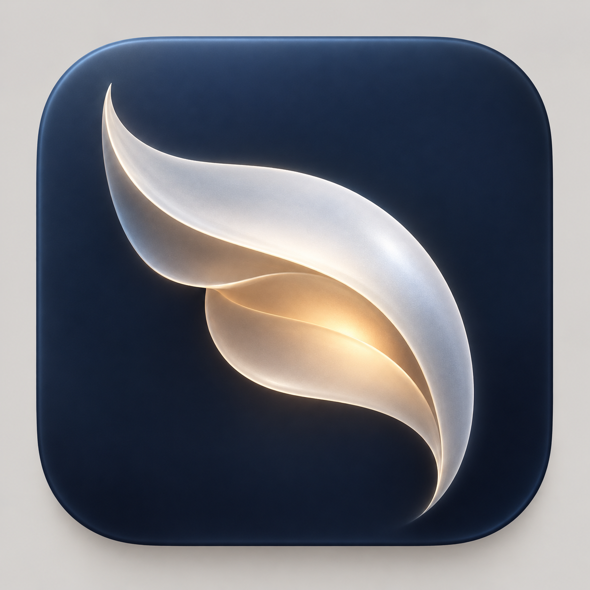
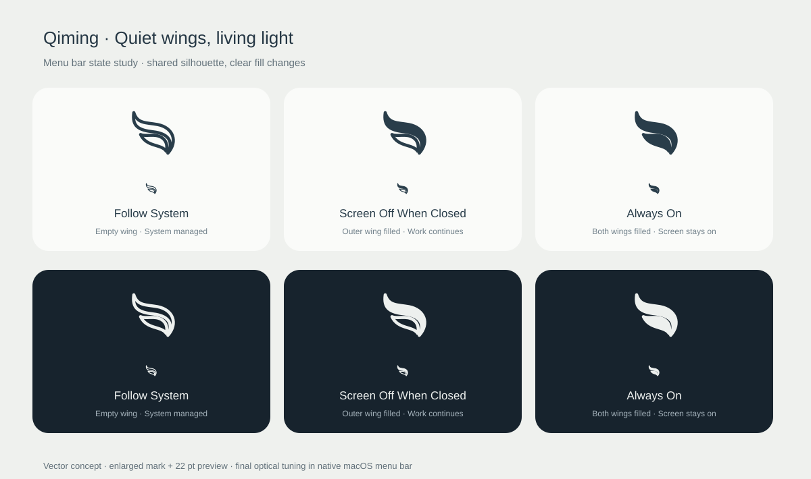

# 栖明·QimingUI 设计稿

版本：产品设计 v2 · 2026-11-03

关联需求：[产品功能与技术栈](Qiming-产品功能与技术栈.md)。本稿仅定义 Mac 内屏场景，不涉及外接显示器。

## 最高设计约束：轻量优先，功能完整

**Qiming 首先追求最小应用包与最低后台开销，其次完整实现约定功能；美观、优雅和唯美通过原生材质、比例、留白与精炼交互实现。**

- AppKit 原生控件和系统 Liquid Glass 构成视觉基础，复用系统字体与符号。
- 主面板、设置和提示按需创建；关闭后停止视觉刷新，释放可释放资源。
- 品牌素材保持少量矢量图形与必要应用图标；不打包字体、视频、壁纸或大型动画资源。
- 动效限于操作反馈和状态切换，界面静止时无持续装饰动画。
- 状态与风险提示使用共享组件；权限、常亮保护和恢复操作有完整入口，布局保持简洁。
- 原生材质随系统设置适配，依靠系统合成完成玻璃效果，不加入第三方渲染库或自制折射引擎。
- UI 交付计入产品总预算：应用及必需辅助组件安装后合计 **≤ 5 MB**，压缩包 **≤ 3 MB**；设计迭代同时检查资源增量。

## 1. 设计概念：一线微光，静静续行

**美观、优雅、唯美是 Qiming 的正式设计要求，也是 UI 交付的验收标准。** 设计通过原生材质、光感、比例、排版和留白表达意境，沿用前述轻量预算。

**审美参考 Apple 原生应用**：精确的比例、舒展的留白、清晰的层级、克制的色彩和细腻的 Liquid Glass。采用熟悉的 macOS 控件、交互与系统材质，融入“栖明”的微光意象，形成 Qiming 自身的视觉识别。

主面板、设置窗口、权限说明与风险提示共享一致的排版、间距、材质和控件语言。优先使用原生控件与系统材质，在最小包体内落实美感；逐一检查简体中文、英语、浅色和深色界面的真实显示效果。

设计过程允许按需使用适合的 skill，不强制使用；以最终视觉质量、交互清晰度和资源预算作为交付依据。设计工具或 skill 的使用不构成应用运行时依赖。

Qiming 的形象是夜色中一道被轻轻收起的光。界面以雾白、墨蓝和少量暖金构成：墨蓝承接夜色，暖金标记仍在运行的任务，留白表达安静。

气质关键词：**安静、清透、克制、温润**。诗意体现在形状、配色和留白，功能文案保持直接；不使用难以理解的诗句代替状态名称。

主要体验是一枚菜单栏图标与一个小面板。用户打开后应立即知道：当前选了什么、电脑是否保持运行、合盖后内屏会怎样。

## 2. 原生 Liquid Glass

### 2.1 实现方向

- **AppKit 原生实现**：菜单栏使用 `NSStatusItem`，自定义内容承载于透明原生 `NSPanel`，保留液态玻璃跨窗口采样。
- **macOS 26 及以上**：对需要自定义玻璃的顶层控件使用 `NSGlassEffectView`，按 API 可用性判断；标准控件优先使用系统外观。
- **旧系统兼容**：macOS 26 以下版本采用 `NSVisualEffectView` 和原生控件降级，不把普通模糊称为 Liquid Glass。
- 不使用网页、第三方玻璃库或自制实时折射着色器，不为玻璃效果打包额外运行时。
- 原生材质仍有合成成本；窗口关闭后不保留装饰动画和不必要的渲染工作。

苹果建议玻璃主要用于界面上层的导航和重要控制，而不是覆盖所有内容。因此本稿采用“**系统材质面板 + 单一玻璃选择层**”：不在每一行外面套独立玻璃卡片。[原生 AppKit 设计说明](https://developer.apple.com/videos/play/wwdc2025/310/)、[材质设计指南](https://developer.apple.com/design/human-interface-guidelines/materials)、[NSGlassEffectView](https://developer.apple.com/documentation/appkit/nsglasseffectview)

### 2.2 材质分布

| 区域 | 处理方式 |
| --- | --- |
| 弹出面板外壳 | 使用原生弹出容器的系统材质与阴影，不叠加第二层全屏玻璃 |
| 三选一策略区域 | 一个共享玻璃承载层，选中行有轻微色调；避免三块强反光玻璃 |
| 状态与倒计时 | 置于稳定、可读的内容表面，不加折射装饰 |
| 设置窗口 | 标准原生窗口、表单与工具栏；玻璃限于适合的顶层导航控件 |
| 权限及异常信息 | 高可读性的不透明程度，文字不透叠到复杂背景上 |

玻璃透明度、反射、阴影与背景响应尽量交给系统，不把视觉稿中的固定透明度作为实现要求。

## 3. 菜单栏图标：从静栖到含光

应用图标采用已确认的 **「栖羽含光」** 方向：两片收拢曲面怀抱暖光。菜单栏从同一母形提炼为单色双翼，通过填充量表达活动程度，形成类似“空杯到满杯”的直观变化。

### 3.1 视觉参考

应用图标参考：



菜单栏三态草图：上排为浅色背景，下排为深色背景；每格同时展示放大形态与 22 pt 小尺寸效果。



### 3.2 三种模式的图形变化

**始终保留相同双翼轮廓与负空间，靠“空心 → 外翼填充 → 双翼填充”表达状态。** 形态保持稳定，填充量一眼可辨；无需依赖文字或颜色区分开启状态。

| 模式 | 图标形态 | 意象 | 中英文辅助标签 |
| --- | --- | --- | --- |
| 跟随系统 | 外翼、内翼均为空心轮廓 | 光已收起，安静栖息 | 跟随系统／Follow System |
| 合盖熄屏，持续运行 | 外翼实心，内翼保留空心，双翼之间留出清晰弧形间隙 | 羽翼收拢，工作在内侧持续 | 合盖熄屏，持续运行／Screen Off When Closed |
| 始终常亮 | 外翼、内翼均实心，保留翼间负空间 | 光感充盈，屏幕持续点亮 | 始终常亮／Always On |

第二种模式在内屏熄灭后仍显示活动图标：填充表示 Qiming 正在保活，而不是表示显示器亮着。第三种模式使用更充盈的双翼填充，传达常亮状态。主面板始终补充完整模式名称。

### 3.3 切换效果

- 用户开启会话、后台确认成功后，图标由空心变为对应填充态；切换过程保持原图标，菜单文字显示正在切换。
- 两种活动模式之间切换，仅改变内翼填充，外翼位置与轮廓保持不动。
- 手动停止、定时结束或保护结束后回到空心态。
- 填充状态采用约 140 ms 的短淡入淡出，视觉上如微光渐盈；最终以像素校准后的静态图像替换，不进行逐帧复杂路径变形。
- 系统开启“减少动态效果”时直接切换静态图标。菜单栏日常运行不闪烁、不呼吸、不旋转。

### 3.4 等待、提示与故障

| 状态 | 图形处理 | 信息呈现 |
| --- | --- | --- |
| 等待接电／手动暂停 | 空心双翼，右侧独立暂停短划标记 | 面板显示暂停原因，恢复成功后切回填充态 |
| 权限未完成／状态读取失败 | 空心双翼，右侧独立感叹标记 | 工具提示与面板显示需处理事项；不使用活动填充态 |
| 高温预警、会话仍运行 | 保留对应活动态，右侧感叹标记 | 原生通知与面板内告警说明温度状态 |
| 过热保护结束会话 | 空心双翼，右侧感叹标记 | 面板显示结束原因；确认告警后恢复普通空心态 |

异常标记使用额外的状态栏宽度，不覆盖羽翼轮廓。提示以文字与形状共同表达，不依赖彩色像素；遇到多个状态时优先显示故障、保护告警，再显示等待。

### 3.5 原生实现与精细度

- 使用 `NSStatusItem` 与原生模板图像，`isTemplate = true`，颜色由 macOS 根据菜单栏背景和选中态处理。
- 主图形以 22 × 22 pt 画布设计，可见曲线约 16–18 pt；提供 Retina 精度并做实际像素校准。示意图中的几何在原生菜单栏继续光学微调。
- 三态共享同一组双翼矢量路径，调整描边与填充；不将彩色应用图标缩小后塞入菜单栏。
- 轮廓线宽以约 1.1–1.3 pt 起步，逐尺寸校准；内外翼保留明显间隙，避免实心状态糊成一团。
- 点击时沿用系统选中背景；图标本身不加玻璃底板、发光阴影或独立圆角框。
- 左键单击展开主面板，再次单击收起；按下时统一处理，避免失焦关闭后在松开时立即重开。右键无会话时开启策略 2，有会话时结束；不弹出上下文菜单，组件未就绪时显示配置提示。
- VoiceOver 标签包括模式、运行／暂停状态；工具提示提供当前模式和定时剩余时间。
- 资源使用少量矢量或原生绘制图像，无持续计时器刷新与第三方动画库，符合最小包体要求。

### 3.6 菜单栏验收

- [ ] 不打开面板即可区分未开启、合盖熄屏保活和始终常亮三种模式。
- [ ] 三态体现“同一羽翼，微光渐盈”的变化，轮廓统一、曲线柔和。
- [ ] 浅深色菜单栏、壁纸透色和系统选中态下均清晰。
- [ ] 实际 1×／2× 显示比例下检查细线、翼间留隙与异常标记。
- [ ] 图标仅在实际模式或告警状态变化时更新；会话结束后与后台状态同步。
- [ ] 菜单栏图形、应用图标与主面板品牌标记采用相同曲线语言。

## 4. 主面板布局

初始尺寸 **宽 352 pt、高约 430–490 pt**，高度随状态与文字增长。内容边距 20 pt，主要区块间距 16–20 pt。所有尺寸为实现起点，需用真实字体与系统控件校准。

以下为第二种策略正在运行的线框；示意线框只表达层级，不要求实现方框边线。

```text
┌────────────────────────────────────┐
│  ◡  Qiming                  ⚙      │
│     Screen off. Work goes on.      │
│                                    │
│  DISPLAY MODE                      │
│  Follow System             [off]  │
│     Use your Mac’s normal behavior │
│                                    │
│  Screen Off When Closed     [on]  │
│     Screen on when open            │
│     Mac stays awake when closed    │
│                                    │
│  Always On                 [off]  │
│     Screen stays on, even closed      │
│     No auto-lock or display sleep    │
│                                    │
│  Keeping your Mac awake            │
│  01:24:36 remaining                │
│  On power · Lid open               │
│                                    │
│  Duration              2 hours  ▾  │
│                                    │
│  [ Turn Screen Off ]   [ Stop ]    │
│                                    │
│  View Status…                Quit  │
└────────────────────────────────────┘
```

### 4.1 顶部

- 品牌图形约 24 pt，标题 `Qiming` 使用系统字体 18 pt、Semibold。
- 标语使用系统次级文字样式；宽度不足时隐藏标语，不缩小功能文字。
- 右上设置按钮提供 `Settings` 辅助功能标签，以文字标签明确表达按钮用途。
- 不显示大幅品牌图，不使用铺满窗口的渐变背景。

### 4.2 三种策略

**核心控件采用纵向策略列表，每行右侧使用 AppKit 原生滑动开关，三项保持互斥。** 左侧文字对齐，不再使用圆形单选标记；整行仍可点击选择。关闭运行中的策略后恢复“跟随系统”；不能关闭“跟随系统”而使三项全部未选。开关使用系统液态玻璃与辅助功能外观，面板仍沿用现有玻璃材质，不叠加额外玻璃透镜。回执成功前维持原选中项，始终常亮先确认风险。

| 选项 | 英文主文案 | 次级说明 | 实际语义 |
| --- | --- | --- | --- |
| 跟随系统 | Follow System | Use your Mac’s normal behavior | 不创建保活或常亮请求，不主动改变显示状态 |
| 内屏常亮，合盖熄屏，持续运行 | Screen Off When Closed | Screen on when open. Mac stays awake when closed. | 开盖保持常亮，合盖主动熄屏并保持系统运行 |
| 内屏始终常亮 | Always On | No auto-lock or display sleep. | 有效会话内开盖、合盖均保持内屏常亮，停用自动锁屏、屏保和内屏睡眠 |

主面板第二项是产品需求中 `Keep Awake · Screen Off When Closed` 的短名称，两者语义一致；界面、日志和诊断使用稳定的策略标识关联，避免名称缩短后变成第四种策略。

每行最小高度约 58 pt，包含多行说明时自然增高。第三项使用 `Always On`，次级文字明确说明合盖常亮和停用自动锁屏。

### 4.3 Always On 风险提示与运行状态

进入 Always On 前，在主面板展示紧凑确认卡：

```text
Keep the screen on while closed?

The built-in screen stays on with the lid closed.
Automatic locking and display sleep are paused.
Long sessions increase image-retention, display
wear, and heat risks. Keep your Mac ventilated.

[ Cancel ]                  [ Enable Always On ]
```

- 每次从其他策略进入 Always On 时显示；点击确认后开启，取消保留原策略。风险确认不设置永久隐藏选项。
- 提示说明“长时间静态显示和高亮度会增加残影与显示老化等损伤风险”，避免使用“必然烧屏”的绝对结论。
- 运行期间显示 `Always On · Auto-lock paused` 和 `Screen-on time 00:42:18`；合盖后保留完整界面状态，开盖可直接查看。
- 默认每 60 分钟显示一次 `Screen has stayed on for 1 hour`，操作为 `Switch Mode` 和 `Stop`；周期在 Protection 中调整。
- 热状态进入 `fair` 时使用系统橙色告警：`Mac is getting warm`，辅文 `Open the lid and keep your Mac ventilated.`，提供 `Screen Off When Closed` 操作。
- 热状态进入 `serious` 或 `critical` 时退出 Always On、熄屏并清理自有保活，显示 `Session stopped to protect your Mac`；状态恢复后由用户手动重新开启。
- 告警采用原生通知和面板内单一告警区域；同一热状态阶段只通知一次。温度保护不可关闭，提醒周期可调整。
- 用户主动锁屏立即退出 Always On，再执行系统锁屏；已锁定的电脑保持原有认证流程。

### 4.4 状态区域

状态用一行主文字和最多两行辅助信息表达，不堆叠仪表盘。

| 状态 | 主文字 | 次级内容 |
| --- | --- | --- |
| 跟随系统 | Managed by macOS | No Qiming overrides |
| 有效会话 | Keeping your Mac awake | 剩余时间、供电来源、合盖状态 |
| 切换中 | Applying mode… | 不提前显示成功 |
| 等待接电 | Waiting for power | Keep-awake requests are paused |
| 权限未就绪 | Setup required | Enable closed-lid support |
| 读取失败 | Couldn’t verify status | Last checked 14:32 · View Details |
| 手动临时熄屏 | Screen turned off | Always-on temporarily paused |

暖金只用于有效运行的状态点或细弧，错误使用系统警示颜色。倒计时使用等宽数字，按秒更新仅限面板可见时；后台结束时间由独立机制管理。

### 4.5 时长与操作

- `Duration` 提供 `Until Stopped`、`30 minutes`、`1 hour`、`2 hours`、`Custom…`、`Until…`。
- 跟随系统时隐藏活动倒计时和 `Stop`，时长控件不发起保活；下次选择活动策略时使用已保存时长。
- 点击第二或第三种策略即按当前时长申请开启会话；切换前保持旧状态，待结果返回后更新选中态。失败时保留最后实际生效状态并说明原因。
- `Turn Screen Off` 为中性次级操作，最小高度 30–32 pt；主动操作时临时释放显示常亮断言，但保留有效会话的系统保活。
- `Stop` 直接结束会话并选中 `Follow System`，不要求额外确认。
- `Quit` 单独放在底部低权重位置；退出前先清理自己的运行状态。
- 到期回到跟随系统，不弹出抢焦点的对话框；通知由用户设置控制。

## 5. 色彩、字体与留白

### 5.1 色彩意向

下列色值为品牌参考，不覆盖系统语义文字和可访问性设置。实际材质随系统背景变化，不要求截图颜色完全一致。

| 色彩 | 浅色参考 | 深色参考 | 用途 |
| --- | --- | --- | --- |
| 雾白 / 夜墨 | `#F4F5F3` | `#151C25` | 内容表面的整体气质 |
| 墨青 | `#304957` | `#A5BCC5` | 少量品牌图形和选中色意向 |
| 微金 | `#97712F` | `#DDC28C` | 运行状态的小面积强调 |
| 主次文字 | 系统 label / secondaryLabel | 系统 label / secondaryLabel | 保障动态对比度 |
| 异常 | 系统橙／红 | 系统橙／红 | 保护触发、失败和冲突 |

选中态遵循系统强调色；微金用于品牌和状态，不强行替换用户的强调色。避免全屏金色、过多光晕与深色文字叠在不可预测的透明背景上。

### 5.2 排版与形状

- 全部正文使用系统字体，不捆绑第三方字体；中文本地化使用系统中文字体回退。
- 标题 18 pt；选项标题 13–14 pt、Medium；正文 13 pt；次级信息 12 pt。
- 基础间距采用 4 pt 倍数；重要信息之间留 16–20 pt，不用密集分隔线切碎界面。
- 面板圆角由原生容器主导；自定义内容圆角约 12–16 pt，与外容器协调，不嵌套大量药丸形卡片。
- 图标优先 SF Symbols 或少量自绘矢量；图标始终有文字或辅助功能说明。

## 6. 设置窗口

初始尺寸 **620 × 440 pt**，使用原生工具栏切换三页：`General`、`Protection`、`Status`。无需复杂侧边栏或搜索栏；内容增长后允许滚动。

```text
┌────────────────────────────────────────────────────┐
│  ● ● ●       Qiming Settings                       │
│          General   Protection   Status              │
│                                                    │
│  Protection                                        │
│  Keep working, with clear limits.                  │
│                                                    │
│  Allow on Battery                         [ on ]   │
│  Stop Below                               [20% ▾]  │
│                                                    │
│  Pause When Power Disconnects             [ on ]   │
│  Resume When Power Returns                [ off ]  │
│                                                    │
│  Thermal Protection                       Enabled  │
│  End the session at a serious thermal state.       │
│                                                    │
│  Closed-Lid Support              Ready   Manage…   │
└────────────────────────────────────────────────────┘
```

| 页面 | 内容 |
| --- | --- |
| General | 界面语言、登录启动、默认时长、可选启动会话、快捷键、通知；首次安装默认跟随系统 |
| Protection | 电池运行、低电量阈值、电源切换、常亮时长提醒、屏幕风险说明和固定热保护；显示辅助组件状态与管理入口 |
| Status | 当前策略、实际断言、合盖状态、状态检查时间、诊断详情与日志导出 |

`Status` 分别呈现所选策略、模块执行状态、实际显示状态和检查时间。读取失败显示具体错误，恢复流程逐项显示清理结果。

高级自动规则和命令行入口后续加入，不在首版预留空白页或不可用按钮。

## 7. 首次使用与权限交互

首次打开直接进入 `Follow System`，可以查看面板，无须先安装组件。

用户第一次选择需要合盖控制的策略时，在面板内展示说明：

```text
Enable Closed-Lid Support

Qiming needs a small helper to manage
closed-lid sessions and restore its changes.

[ Not Now ]                      [ Set Up… ]
```

辅助组件安装流程依次完成用途说明、系统批准、连接校验和完成反馈。用户取消时回到之前实际生效的策略，不显示虚假的已开启状态。安装后提供无外屏验证指引，分别检查内屏显示与任务是否持续运行。

权限文字使用可展开的 `What changes?` 说明具体电源操作及卸载方式，避免在主面板长期展示命令行细节。

## 8. 中英双语、动效与无障碍

首版完整提供简体中文与英语。`General / 通用` 中设置 `Language / 语言`，选项为 `Follow System / 跟随系统`、`简体中文`、`English`。默认跟随系统，其他语言环境使用英语；切换语言更新全部界面，保留当前会话和倒计时。

| 简体中文 | English |
| --- | --- |
| 跟随系统 | Follow System |
| 合盖熄屏，持续运行 | Screen Off When Closed |
| 始终常亮 | Always On |
| 立即熄屏 | Turn Screen Off |
| 结束会话 | Stop |
| 通用／保护／状态 | General / Protection / Status |

策略说明、风险确认、高温及低电量告警、通知、权限说明、错误信息和辅助功能标签均提供双语版本。文稿中的英文线框对应英语界面，中文版本沿用相同视觉层级与交互。

使用系统字体和原生 String Catalog；按中英文实际长度换行、调整行高，不以固定字符数裁切。日期、时长与数量使用本地化格式。两种语言共享组件、图标和材质，仅存储必要文案，遵守包体预算。

- 面板展开约 200 ms 淡入、收起约 160 ms 淡出；策略内容与确认卡片约 200 ms 淡变，高度变化保持顶部锚定。请求中保留当前高度，结果确认后再调整。
- 仅面板内状态灯按既定状态轻缓呼吸；面板隐藏时停止，不做流动背景或菜单栏图标持续动画。
- 跟随原生控件反馈，不为装饰加入独立高频刷新。
- 开启“减少动态效果”时关闭展开／收起、内容与高度过渡和状态灯呼吸。
- 开启“降低透明度”时使用系统支持的更实表面；可读性优先于玻璃效果。
- 支持增强对比度、键盘焦点、VoiceOver；以系统无障碍状态作为实现依据。
- 三项策略使用原生开关辅助功能语义，组说明明确“一次只启用一种策略”；键盘可选择并激活，焦点样式清晰。
- 颜色不作为唯一状态标识；未知、等待和失败必须有文字。
- 长文本、本地化和放大显示下自然换行，完整展示第三种策略的屏幕与热风险说明。

## 9. UI 验收清单

- [ ] 按 Apple 原生应用的审美标准检查比例、留白、层级、控件对齐与材质；主面板、设置和提示形成统一、精致的完整体验。
- [ ] 完成“简体中文 × 浅色、简体中文 × 深色、英语 × 浅色、英语 × 深色”四组真实界面截图评审，并核对不同壁纸下的效果。
- [ ] 简体中文和英语覆盖全部用户可见文案及辅助功能标签，三种策略名称与语义一致。
- [ ] 语言切换保留活动会话、到期时间和策略；跟随系统及其他语言回退英语正确生效。
- [ ] 两种语言分别检查主面板、设置、风险确认与异常提示，文字完整、布局舒展、无意外语言混用。
- [ ] 整体呈现美观、优雅、唯美的视觉气质：层级清楚、比例协调、留白舒展，光感与暖金强调克制统一。
- [ ] 使用真实窗口检查浅色、深色以及明亮、暗色、复杂壁纸背景；保留各场景截图核对材质、文字与选中态。
- [ ] 主面板、设置、权限提示和告警沿用统一的字体、间距、圆角及材质规则，视觉细节在真实控件中落实。
- [ ] 默认展示跟随系统，用户无需理解断言或全局设置即可知道当前未干预。
- [ ] 三种策略的开盖／合盖行为均与产品需求一致，没有额外隐含模式。
- [ ] macOS 26 及以上使用原生 Liquid Glass，旧系统使用原生系统材质。
- [ ] 浅色、深色、纯色及复杂壁纸背景下文字均清晰。
- [ ] 降低透明度、减少动态效果、增强对比度均正确响应。
- [ ] 第二种策略强调“开盖常亮、合盖熄屏、任务继续”，第三种策略明确合盖常亮、无自动锁屏、无内屏睡眠。
- [ ] 切换中、权限取消、辅助进程失败、低电量及过热状态不会显示虚假的运行成功。
- [ ] 停止后返回跟随系统；面板状态与后台实际状态同步。
- [ ] Always On 每次开启展示风险确认，运行中显示自动锁屏停用和常亮时长。
- [ ] 完全合盖后内屏继续常亮，不进入自动锁屏、屏保和内屏睡眠。
- [ ] 高温分级提示、保护退出与常亮时长提醒符合产品规则。
- [ ] 用户主动锁屏退出 Always On；模式退出后恢复原自动锁屏状态。
- [ ] 面板关闭后无持续装饰动画，整体资源占用仍符合技术方案目标。
- [ ] 按本稿完成结构、交互与视觉验收，玻璃材质由系统原生渲染。

## 10. 设计交付结论

Qiming 的首版 UI 采用：**一枚微光图标、一个原生材质面板、一个玻璃策略选择层、三种清晰模式，以及一处可信的运行状态。** 视觉重点放在内屏与任务的关系，保持安静、轻量和可理解。

## 11. 应用图标设计稿：栖羽含光

### 11.1 意象与形态

**一片轻轻收拢的羽翼，将未熄的晨光藏在曲线之间。**

以低伏、包覆的外曲面表达“栖”：安静、收拢、休憩。以内侧透出的暖光表达“明”：屏幕收起后，工作仍然延续。意境通过曲面的聚拢与光的流露传达，形态不直接描画电脑。

主体由两片相互呼应的弧形曲面构成：外侧是一道珍珠银的长弧，内侧是一道香槟金的短弧。两者沿柔和的 S 形走势收拢，形成一处含光的留隙。轮廓不对称，重心安稳，转折柔和；尖端渐细，腹部圆润，形成舒展的呼吸感。

### 11.2 构图

- 底板采用系统应用图标轮廓，主体居中略偏上，四周留白充分。
- 外曲面自左下舒展至右上，再向内轻轻收拢，像静栖时折起的羽翼，也像被风轻托的丝绸。
- 内曲面顺着外侧走势回旋，面积小于外曲面，形成环抱的关系。
- 暖光沿内侧缝隙自然显露，与曲面融为一体；不采用独立圆点、横条或具象屏幕。
- 主体占图标宽度约 60%–66%、高度约 56%–62%；曲面比例以视觉稿的光学平衡校准。
- 盖合的含义通过包覆姿态表达，工作的延续通过内在光感表达。最终形态保持抽象，不添加鸟眼、羽毛纹理、星星或风景。

### 11.3 色彩与材质

| 元素 | 视觉定义 |
| --- | --- |
| 底板 | 去饱和的夜墨蓝，中心轻亮，边缘沉静，色调与主面板一致 |
| 外曲面 | 珍珠白与雾银，柔和圆润的体积，边缘有克制的玻璃透光 |
| 内曲面 | 淡香槟与温润琥珀，光线从曲面内部透出 |
| 留隙 | 保留深色负空间，衬托内在暖光与曲面方向 |
| 高光 | 顺着弧线流动的细光，局部明亮，整体柔润 |

质感结合原生玻璃的通透与玉石般的温润。避免强烈镜面、硬切倒角、霓虹轮廓与过度曝光。参考 Apple 原生图标对曲面、纵深和光学比例的精细处理，形成 Qiming 自身的辨识度。

### 11.4 原生适配与轻量资源

- 默认、深色、系统着色外观共享同一曲线母形，依靠明暗和轮廓保持识别。
- 菜单栏图标提炼外曲面与留隙的单色剪影，与应用图标使用相同走势；具体运行状态通过实心、轮廓及状态标记表达。
- 16／32 pt 下减少细微高光，扩大关键负空间，保留收拢曲线的识别。
- 正式资源以精简矢量曲面与系统支持的图标图层制作。生成参考图保留在设计资料中，不直接作为大型原图打包。
- 图标资源统一计入应用及必需辅助组件合计 ≤ 5 MB 的预算。

### 11.5 视觉参考与验收

参考图采用 imagegen 内置生成工具制作，用于确定曲线、意境和材质；正式图标按原生图标流程制作与像素校准。


生成提示词摘要：单一 macOS 应用图标；夜墨蓝底板；两片收拢的珍珠银与香槟金曲面，如羽翼怀抱晨光；柔和 S 形走势、不对称留白、温润透光；无文字、无横条圆点、无具象电脑、无繁复装饰。

- [ ] 曲线舒展、收拢自然，呈现“栖羽含光”的包覆与延续感。
- [ ] 第一眼看到整体优美的形态，进一步观看感受到内侧未熄的暖光。
- [ ] 简洁、美观、优雅、唯美；轮廓独特，材质细腻，留白安静。
- [ ] 光与曲面融合，不出现孤立横条或圆点构图。
- [ ] 小尺寸、浅深色背景与系统着色外观均保持清晰识别。
- [ ] 应用图标、菜单栏图形和界面品牌标记共享曲线语言。
