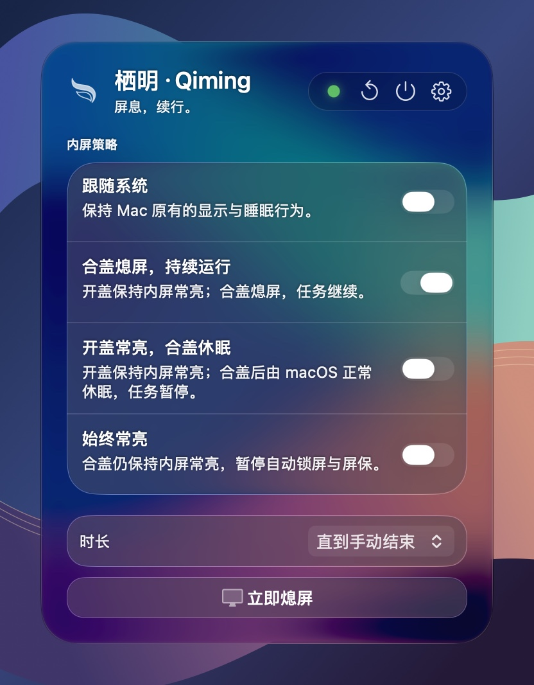
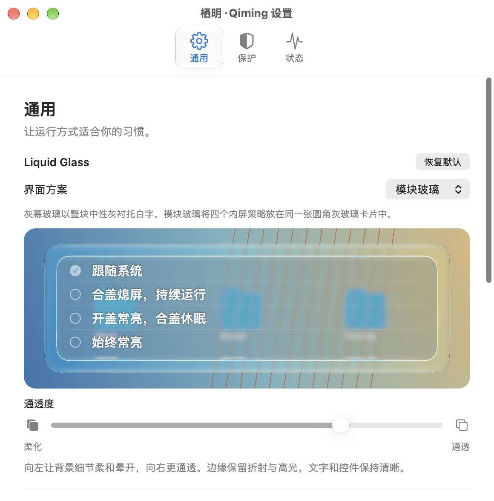
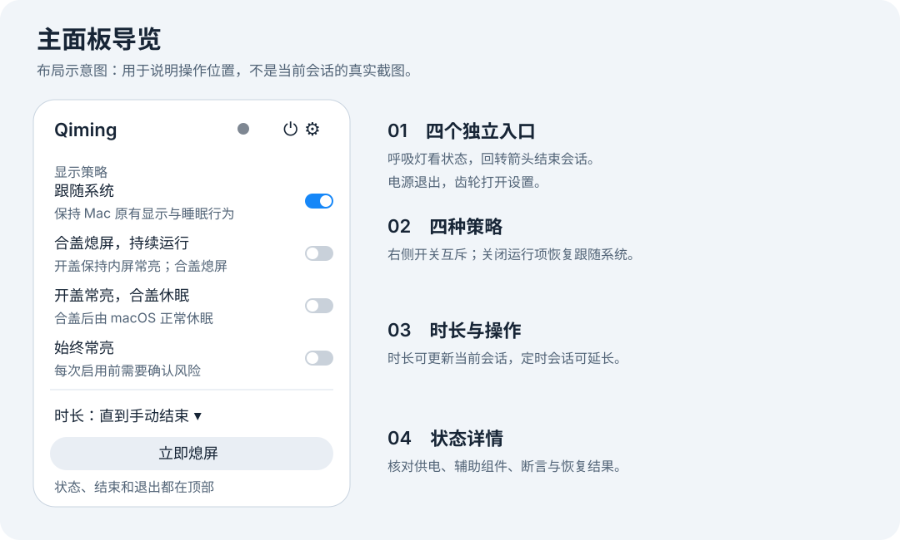
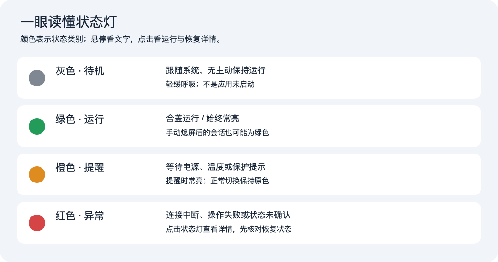
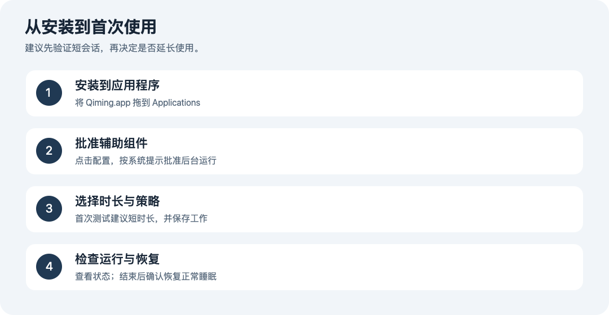

<p align="center">
  
</p>

# 栖明 · Qiming

栖明是一款原生 macOS 菜单栏应用，用来控制 MacBook 的内屏和睡眠行为。可以定时保持常亮，也可以在合盖熄屏后让下载、运算等任务继续运行。

[图文使用手册](Documentation/使用手册/Qiming使用手册.md) · [产品与技术设计](Qiming-产品功能与技术栈.md) · [图标设计](design-assets/qiming-icon-v2/README.md)

## 原生液态玻璃

在 **macOS 26 及以上**，栖明使用 AppKit 的原生 `NSGlassEffectView`（Clear 样式）。主面板和模块玻璃卡片保留系统绘制的圆角折射与边缘高光。文字和控件独立绘制，调节通透度时只柔化背景。

<p align="center">
  
</p>
<p align="center"><sub>macOS 27.2 实机截图 · 彩色背景下的模块玻璃主面板（演示状态）</sub></p>

在「**设置 → 通用 → Liquid Glass**」可以切换界面方案，并用实时预览调节通透度。滑块向左柔化背景细节，向右让背景更通透。macOS 14–15 使用 `NSVisualEffectView` 提供备用材质。



## 系统要求

- 当前构建目标为 **Apple 芯片（arm64）和 macOS 14 或更新版本**。Intel Mac 需要另行构建和验证。
- macOS 26 及以上使用原生 Liquid Glass。较早的受支持系统使用备用材质。
- 使用 Swift、AppKit、IOKit、ServiceManagement 和 XPC，无第三方运行时依赖。

## 使用方式

打开栖明后，**左键**点击菜单栏的羽翼图标可展开或收起面板。**右键**在没有会话时开启「合盖熄屏，持续运行」，有会话时结束当前会话。



| 策略 | 开盖时 | 合盖时 |
| --- | --- | --- |
| 跟随系统 | 按 macOS 设置处理显示和睡眠 | 由 macOS 管理 |
| 合盖熄屏，持续运行 | 内屏保持常亮 | 请求熄屏并保持系统运行 |
| 开盖常亮，合盖休眠 | 内屏保持常亮 | 允许 macOS 正常睡眠 |
| 始终常亮 | 内屏保持常亮 | 尝试保持内屏点亮和系统运行，每次开启前需确认风险 |

可设置会话时长或结束时间，也可以立即熄屏、提前结束会话。低电量和温度保护会按当前规则处理活动会话。状态页可查看辅助组件连接、系统断言和恢复结果。



## 安装与首次配置

从源码构建或取得安装包后，将应用放入「应用程序」目录再打开。DMG 内可直接将应用拖到 Applications。

首次启用需要辅助组件的策略时，在「设置 → 保护」点击「配置…」，按 macOS 提示完成批准。更新或卸载前，请先结束会话并确认睡眠设置恢复。



## 从源码构建

项目已包含 Xcode 工程和共享 Scheme。当前构建使用 **Xcode 27.2**。命令行脚本需要 Python 3，默认查找 `/Applications/Xcode.app`，也可通过 `DEVELOPER_DIR` 指定其他 Xcode。

1. 在项目根目录创建本地文件 `Config/Signing.xcconfig`，将下面的占位符换成自己的 Apple 开发团队 ID。主程序和辅助组件共用这份签名配置。

   ```xcconfig
   DEVELOPMENT_TEAM = YOUR_TEAM_ID
   CODE_SIGN_IDENTITY = Apple Development
   ```

2. 用 Xcode 打开 `Qiming.xcodeproj`，选择 **Qiming** Scheme 和 **My Mac**，按 **⌘R** 运行 `Qiming Dev.app`。
3. 在「设置 → 状态」确认辅助组件通信正常后，再尝试开启合盖会话。

```sh
./Scripts/build.sh Debug
./Scripts/test.sh
```

仅检查界面或运行不需要签名的测试时，可以创建空的 `Config/Signing.xcconfig`，并用 `QIMING_UNSIGNED=1 ./Scripts/build.sh Debug` 构建界面预览。未使用开发者签名的构建无法注册特权辅助组件。

## 打包与分发

结束会话并退出日常版后，可用以下命令打包。

```sh
./Scripts/build.sh Release
```

脚本会在本机更新 `/Applications/Qiming.app`，核对辅助组件回执，并生成 `dist/Latest/` 下的 DMG、ZIP 和 SHA-256 校验文件。

当前脚本生成的是 **Apple Development 签名的本机使用包**。对外分发需要另行完成 Developer ID 签名、公证和目标设备验证。完成分发准备后，可将安装包和校验文件作为 GitHub Releases 附件发布。

## 已知限制

- 合盖持续运行使用系统全局睡眠设置。会话期间，Apple 菜单中的「睡眠」可能变灰。结束会话后可恢复原设置。
- 如果其他工具在会话期间同时修改相同的全局睡眠设置，系统无法可靠区分设置归属。
- 已验证短时合盖熄屏、会话到期和退出恢复等场景。完全合盖常亮与长时间无人值守仍需实机验证。状态页的系统回执不能代替对物理屏幕的观察。[主要功能验证记录](Documentation/主要功能验证记录.md)

## 项目结构

| 目录 | 内容 |
| --- | --- |
| `Qiming/` | 菜单栏主程序、面板、设置和本地化资源 |
| `QimingHelper/` | 特权辅助组件，负责电源策略、会话和恢复 |
| `Shared/` | 共享协议、策略规则和系统接口 |
| `QimingTests/` | 规则和辅助组件状态机测试 |
| `Config/` | 应用与后台服务配置 |
| `Scripts/` | 构建、测试、打包和工程生成 |
| `Documentation/` | 使用手册、设计说明和验证记录 |
